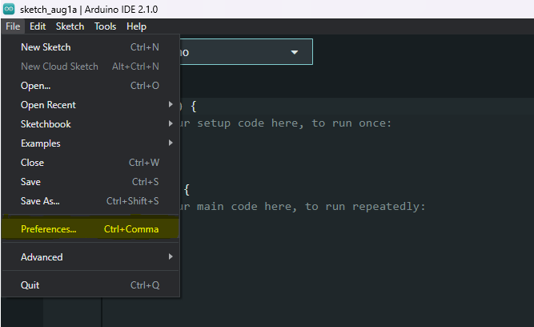
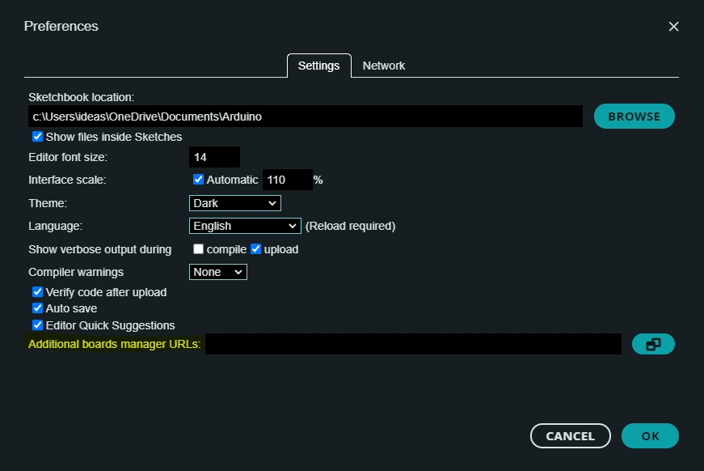
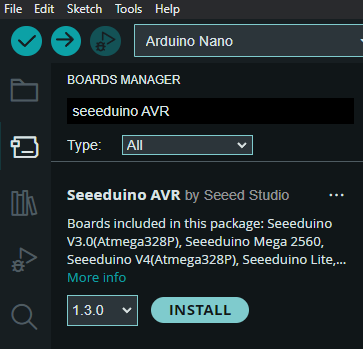
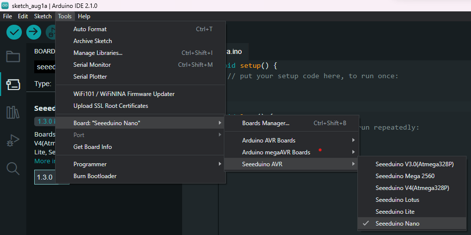
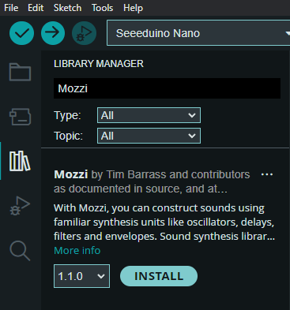
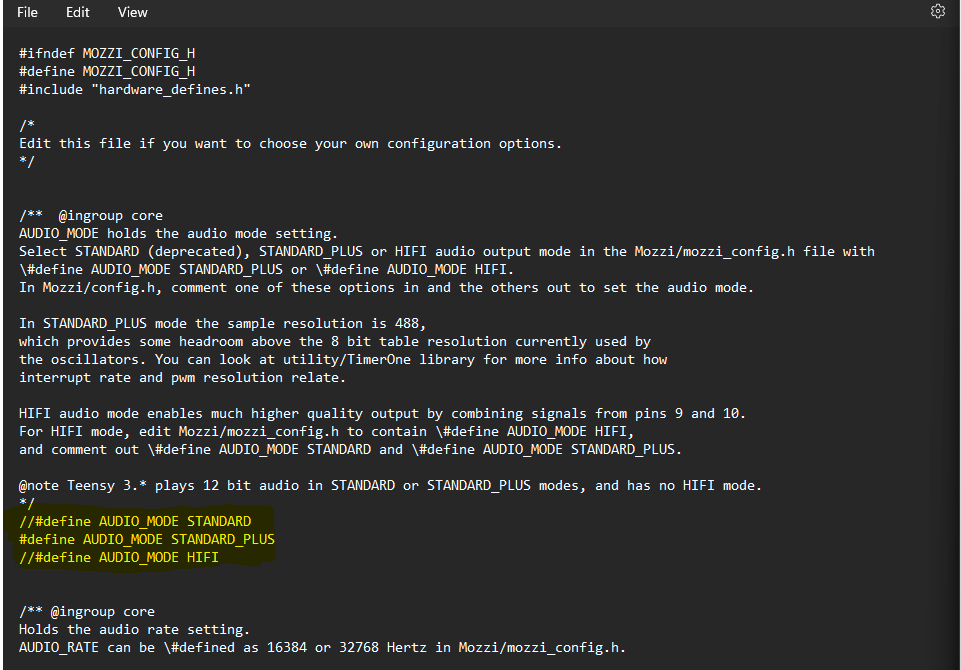
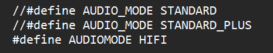
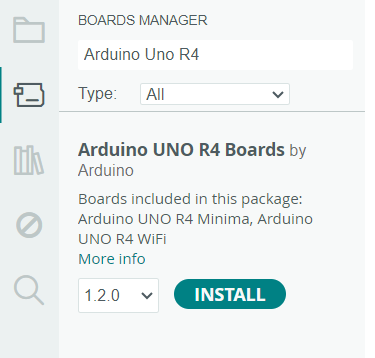
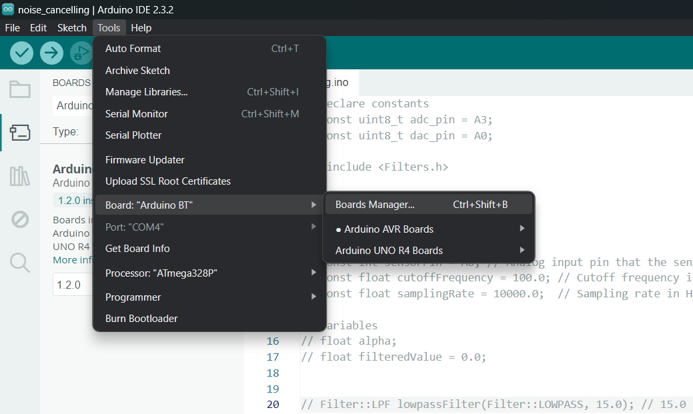

# NOTICE

Hello to you from the Pearl Sullivan Engineering IDEAs Clinic team. We
hope that you will enjoy this year’s Tron Days that we have made for
you. To help the event run smoothly for you and our team we ask that you
please read through this document and complete all tasks before Day 1 of
Tron Days. If you require any additional assistance please contact us by
email at <engideas@uwaterloo.ca> or by dropping by the second floor
Ideas Clinic office located in E5-2112 where our Co-op research
assistants will be happy to help you.

# Required Software Downloads and Configuration

Please install the following software **<u>before</u>** Day 1 of Tron
Days:

## Audacity

Audacity is a free and open-source DAW (digital audio workstation) which
you will be using to explore the mathematics of sound waves.

### Download: 

> [Click here to go to Audacity’s website and download
> it](https://www.audacityteam.org/). Make sure that you download the
> correct version for your operating system. **Choose the “Download
> without Muse Hub “option**

### Installation:

Proceed to install Audacity.

### Configuration:

None Required.

## AutoCAD

AutoCAD and many other programs from Autodesk are free to you as a
University of Waterloo Engineering Student. If you do not already have
AutoCAD and a student account, please follow the instructions in the
sections below.

### Student Account Set-Up

1.  Follow this link to set up your [student Autodesk
    account](https://www.autodesk.com/education/edu-software/overview?sorting=featured&filters=individual).

2.  Click on “Get Started” on the webpage.

3.  Under the drop-down menu for “Educational Role”, select “Student”.

    1.  Proceed to enter the information required.

    2.  ENSURE THAT YOU USE YOUR UWATERLOO EMAIL.

4.  You will get confirmation email from Autodesk to your UWaterloo
    outlook email account. Follow the instructions in the email to
    activate your Autodesk Student Account.

5.  Once this is completed, please proceed to download AutoCAD.

## 

## Arduino IDE

Arduino IDE is a free and open-source integrated development environment
(IDE) for Arduino and Arduino compatible boards. Since we will be using
an Arduino compatible board rather than one directly from the
manufacturer there will be a few extra steps that we will be walking you
through. **Please follow the steps below closely as this will ensure
that you do not spend a considerable amount of time trying to debug
seemingly nonsensical technical issues, we have already done this for
you so please learn from our suffering.**

### Download

Ensure that you have the latest version of Arduino IDE downloaded. You
can find it here by following this
[link](https://www.arduino.cc/en/software). Once downloaded proceed to
install Arduino IDE on your computer. Their will be options for each
operating system on the right

### Configuring Arduino IDE for the Seeeduino NANO

Once installed open Arduino IDE and go to Files/Preferences,
alternatively you can use the shortcut Control + Comma on windows or
Command + Comma on Mac.

You should then see the menu below on your screen. Under the highlighted
section, “Additional boards manager URLs”, paste the following link:
<https://raw.githubusercontent.com/Seeed-Studio/Seeed_Platform/master/package_legacy_seeeduino_boards_index.json>

You can now press the “OK” button which will close the Preferences Menu.
Wait for Arduino IDE to download the information from the link that you
entered then restart the IDE.

Once you reopen Arduino IDE open the Boards Manager Pannel which can be
found on the left-hand side of the IDE or use the shortcut Control +
Shift + B on Windows or Command + Shift + B on MacOS. Paste the
following into the Boards Manager search bar: Seeeduino AVR. Now select
“Install”.

Once the installation is complete select the Seeeduino Nano by clicking
Tools/Boards/Seeeduino AVR/Seeduino Nano, as shown below.

### Setting Up the Mozzi Library

#### Installing the Mozzi Library

Go to the library manager in Arduino IDE by clicking on the Library Icon
on the left-hand menu in Arduino IDE or by using the shortcut Control +
Shift + I on Windows or Command + Shift + I on MacOS (Not that the last
key in the shortcut is an ‘i’).

Type Mozzi Into the search bar and select install. This should default
to the latest version of Mozzi but please make sure that **version
1.1.0** is selected.

\*\*The Arduino IDE will later ask you to update all the libraries, Do
not update or this will alter the changes in the library you made.

#### Configuring Mozzi

Since you will be dealing with a pre-designed printed circuit board
(PCB) that has been made to work with Mozzi’s HiFi (high fidelity) mode
we need to edit one of the files that’s part of the Mozzi Library. **If
this step is not taken, then your synthesizer will not work properly**.
These instructions will be the same for all operating systems, but the
file location may be a little different. Currently for both MacOS and
Windows 10/11 you will need to find the Arduino folder that by default
is in your Documents folder regardless of operating system.

Open the following folder with the folder path
Documents/Arduino/libraries/Mozzi. Inside of the Mozzi Folder find the
file named “mozzi\_config.h”.

Right click the file named “mozzi\_config.h” and select open with, on
windows select Notepad and on MacOS select TextEditor. Once in the file
look for the highlighted code in the picture below:

This code is a header file for Arduino C. The change we will need to
make to the section is to edit the highlighted block to read as follows:

All we are doing is commenting out the previous mode which was
STANDARD\_PLUS, and uncommenting the HIFI mode which will allow our
Mozzi program to behave correctly with the PCB you will be using. **Save
the change to the mozzi\_config.h file** and close the text editor that
you used on your respective operating system. Now Mozzi is configured
for the TRON DAYS activity. If you are interested in why we must set
Mozzi to HIFI mode, then there is a section explaining this in the
design overview.

### Configuring Arduino IDE for the Arduino UNO R4

Once installed open Arduino IDE and go to Tools. Hover over Board and
select Boards Manager. A menu should appear on the left side of the
environment. In the search bar enter “Arduino UNO R4 Boards”. Install
Boards by Arduino.

# Sneek Peek of TRON DAYS Challenge 

Here is a short video (we tried to find one that was vaguely
entertaining) to familiarize you with one of the main topics of TRON
DAYS, the activity will make more sense if you have this background
information.

[ADSR Explained: The Four Forces That Shape Your
Sound](https://www.youtube.com/watch?v=mKSo2ANMSEE&t=196s)

**Important note**: Please make sure to bring with you pencils, paper, a
protractor (optional), and other tools you may need for sketching or
designing!

# Additional Resources

Here is a list of additional resources that you may want to keep handy
for the TRON DAYS activity that you will be doing. The Mozzi
Documentation is very useful if you are trying to debug and the Learning
Synths document from Ableton is very helpful if you have no prior
experience with synthesizers. Additionally, VCV Rack has a free
open-source version available that we’d encourage you to play around
with if you’d like a bit of hands on experience with synthesis before
TRON DAYS, please note that this is the most optional link as it’s more
for you to experiment with if you have the interest to do so.

1.  [Learning Synths |
    Ableton](https://learningsynths.ableton.com/en/get-started)

2.  [Mozzi Documentation | Arduino Mozzi
    Library](https://sensorium.github.io/Mozzi/doc/html/index.html)

3.  [VCV Rack](https://vcvrack.com/Rack#get)
