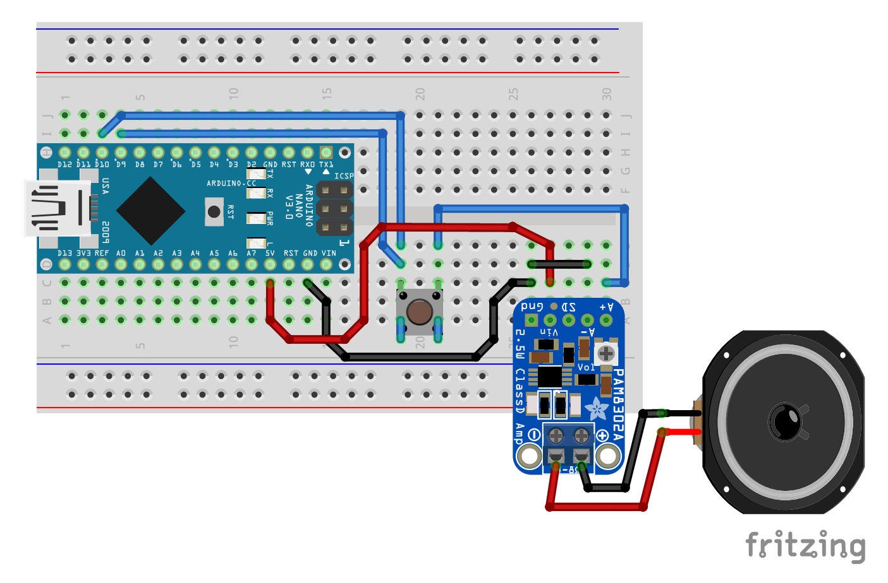
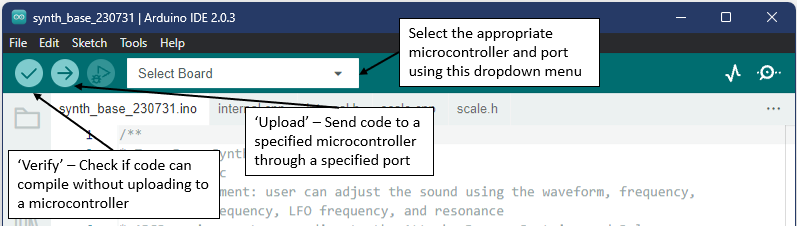
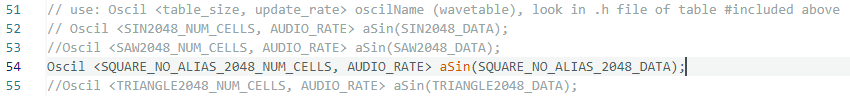
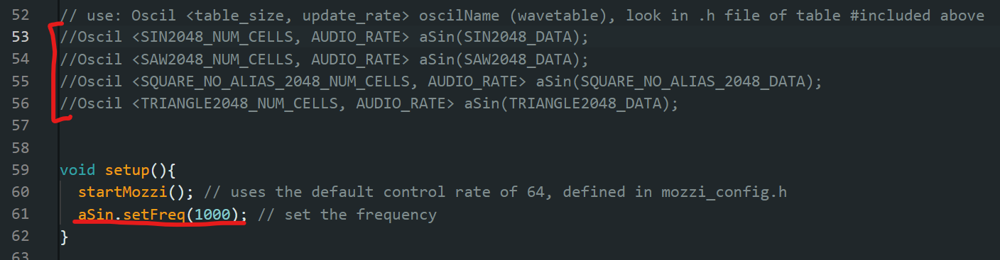
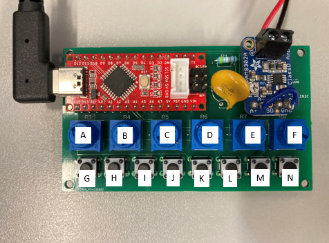
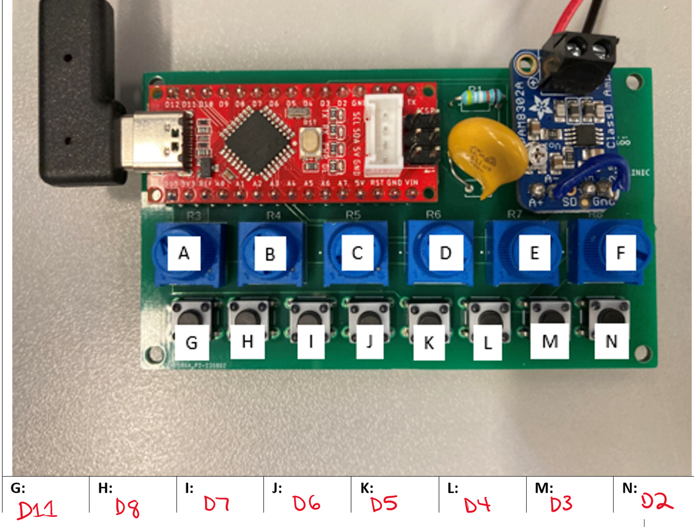
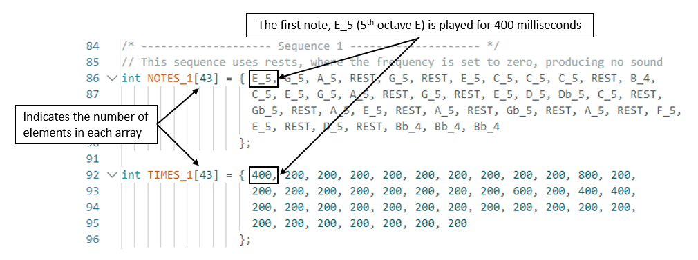
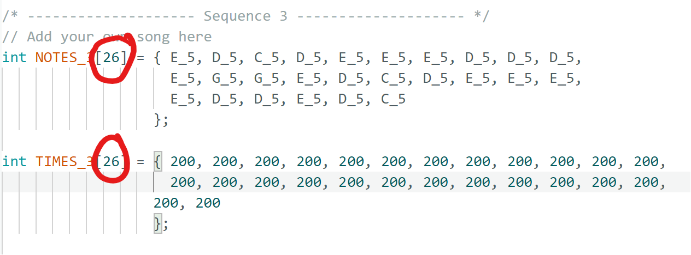
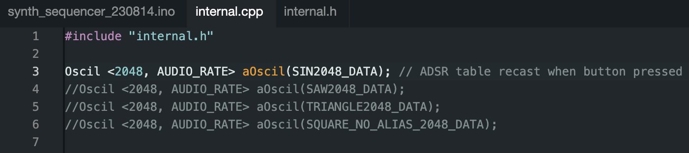

## Workshop 1
In many modern songs, we hear sounds that are not recognizable as
traditional instruments such as the guitar, piano, violin, drums. These
sounds are created by electrical musical instruments called
synthesizers, or a software imitation thereof! As their name might
suggest, most of the first synthesizers were originally made with the
goal of artificially reproducing (or synthesizing) the sounds of
acoustic instruments like those listed above. Over the decades, they
have evolved into being their own category of instrument with their own
distinct sounds rather than trying to imitate acoustic instrument.
Analog synthesizers typically create sounds by generating waveforms
through methods including subtractive synthesis, additive synthesis, and
frequency modulation (FM) synthesis. These sounds may be altered by
components such as filters, which cut or boost frequencies; envelopes,
which control articulation or how notes begin and end; and low-frequency
oscillators, which modulate parameters such as pitch, volume, or tone.

## Manipulating Sound Waves

Follow the instructions outlined in
F26\_TD\_Manipulating\_Sound\_Waves.docx.

## Recreating a Piano Note

Follow the instructions outlined in
F26\_TD\_Recreating\_a\_Piano\_Note.docx.

Once you finish this activity, play ***sine\_wave\_approx.wav*** for the
teaching team to receive materials for the next activity.

**Circuit:** Start by wiring up a circuit to test the speaker, as shown
in the diagram below:

You will run a program that outputs various waves. The BASIC\_CIRCUIT
\_CHECK.ino code reads the values from the digital pins and prints them
to the serial monitor.

1.  Download and open BASIC\_CIRCUIT \_CHECK.ino. After the IDE opens, a
    popup window may appear, prompting you to create a new folder to
    store your project in. Choose ‘**Ok**’. The IDE should look like
    this:

1.  Using the provided USB-C to USB-A cable, plug your Seeeduino Nano
    into your computer. An LED on the Seeeduino Nano should turn on,
    indicating that it is receiving power.

2.  Next, select the appropriate board and port that you will be
    uploading your code to. From the ‘**Select Board**’ dropdown menu,
    choose ‘**Select Other Board and Port**’ and choose ‘**Seeeduino
    Nano**’. Select the port that appears in the ‘**Ports**’ menu, then
    select ‘**OK**’ to close the pop-up window.

**NOTE if you cannot select a port then then
you need to install a driver**

1.  Download and install the driver (make sure to unzip the downloaded
    driver folder)

2.  Open device manager

3.  Click on the seeeduino tab (check under Other Devices) and pick
    install drivers

4.  Browse to downloaded driver and select it to be installed

5.  If you are having trouble, then ask for help

<!-- -->

1.  Run your code. It is a good idea to verify that your code works
    before uploading it to the microcontroller. Press the ‘**Verify**’
    check mark button. The output window should appear after the code
    finishes compiling.

2.  If there are no error messages, proceed by sending the code to the
    synthesizer using the ‘**Upload**’ arrow button. A message should
    appear in the Output once the upload has finished.

3.  To change the wave that is outputted, change lines 52-55 so that a
    different line is uncommented, then upload the new code to the
    Seeeduino Nano. Use ‘**Ctrl**’ + ‘**/**’ to comment and uncomment.

    *Note: The code initially plays a sine wave. To play a square wave,
    comment line 52 and uncomment line 54 as shown below.*

**Sketch and Construction**

1.  Based on your observations of the speaker, brainstorm design
    objectives for a cab to house this speaker. As a group, choose 3
    design objectives that you believe are the most important for your
    design.

<table>
<colgroup>
<col style="width: 50%" />
<col style="width: 50%" />
</colgroup>
<thead>
<tr>
<th>Design Objective #1</th>
<th></th>
</tr>
</thead>
<tbody>
<tr>
<td>Design Objective #2</td>
<td></td>
</tr>
<tr>
<td>Design Objective #3</td>
<td></td>
</tr>
</tbody>
</table>

1.  Spend 10 minutes sketching a design idea for the speaker cab based
    on your group’s design objectives. Each group member should sketch
    their own design individually. Set a timer to help your group stay
    on track.

2.  Take turns presenting your ideas to the group. Explain how you
    incorporated the design objectives into your sketch.

3.  As a group, choose the design you want to build. Consider how
    feasible it is to build the design using the provided materials. If
    you have a design that requires more materials, you may ask for more
    cardboard to but MUST justify why the increased materials cost is
    required.

4.  Make a <u>scale drawing in AutoCAD</u> of your
    cardboard cutouts that will used to assemble your speaker.

    1.  Note that all of your cutouts will have to
        fit on a 12x12” sheet of cardboard.

    2.  Your cutting lines should be object lines,
        and folding lines should use hidden lines.

    3.  You must have a title block (the size/shape
        of the block doesn’t matter for this time) with the name of the
        speaker, the names of your group members, and the scale of your
        drawing.

    4.  Add notes to communicate supplemental
        information, as needed.

5.  Receive a speaker from a TA and proceed to
    assemble your speaker cabinet using the provided cardboard and hot
    glue guns.

## Day 1 Presentation

Groups will be asked to give a brief (no longer than 5 minutes)
presentation of their design to the TAs. For this brief presentation
each group will be asked to cover the following:

1.  Present your final sketches, and any other design documents that
    they think are important to show their design process.

2.  Discuss your group’s main design objectives and key features of the
    design that help it achieve its design objectives. Be sure to
    describe any changes your group made as you constructed the speaker
    cab or changes you recommend for future iterations.

3.  Demo your speaker design and allow the TAs to get a measurement of
    your speaker cab’s loudness. For this you must have the waveform set
    to the default Sine Wave in your code with a frequency value set to
    1 kHz (this is the standard test tone).

### Loudness Competition

Each group will have their speaker loudness measured by the WEEF TAs or
IDEAS CLINIC CO-OPS. You will be allowed to only change two parameters
in the code for the loudness measurement:

1.  The wave table can be selected by uncommenting the table that you
    wish to use.

2.  The frequency of the oscillator can be set.

### Design Aesthetic Competition

Each group will have their design evaluated from an aesthetic
perspective by the WEEF TAs or IDEAS CLINIC CO-OPS. One winner will be
chosen from each stream.

# Day 2 – Oct. 9

## Assemble Synthesizer

The synthesizer you will be creating has two modes that you can switch
between by pressing a button. One mode is called the ‘**LFO state**’,
while the second mode is ‘**ADSR state**’.  These modes are controlled
by potentiometers.

- ‘LFO state’ potentiometers

  - Waveform (sine, triangle, saw, and square waves)

  - Frequency/Pitch

  - Cutoff/Intensity

  - LFO Cutoff rate

  - Resonance (i.e. the vibrating quality of the sound)

  - Amplitude/volume

- ‘ADSR state’ potentiometers

  - Attack 

  - Decay 

  - Sustain 

  - Release

The basic design of the synthesizer also includes one button that will
play a single note according to attack, decay, sustain, and release
values. If you haven’t watched it already, [this
video](https://youtu.be/mKSo2ANMSEE?si=SVDKjxPIVjyonnV4)—which was
linked in the prerequisites document—is helpful in understanding more
about how ADSR works and sounds.

The teaching team will provide you with the following parts to construct
the synthesizer. Before you begin, please ensure that you have all of
the materials listed below:

<table>
<colgroup>
<col style="width: 50%" />
<col style="width: 50%" />
</colgroup>
<thead>
<tr>
<th>Component Name</th>
<th>Number of Components</th>
</tr>
</thead>
<tbody>
<tr>
<td>Seeeduino Nano</td>
<td>1</td>
</tr>
<tr>
<td>PCB</td>
<td>1</td>
</tr>
<tr>
<td>USB-C Cable</td>
<td>1</td>
</tr>
<tr>
<td>Cardboard Speaker Cab Design (from Day 1)</td>
<td>1</td>
</tr>
</tbody>
</table>

You have also been provided with the following project folders, which
you will need to use to run your synthesizer:

- PCB\_CONNECTION\_CHECKER

- SYNTH\_BASE

- SYNTH\_SEQUENCER

**Getting started:**

First, let’s ensure that each button and potentiometer is properly
soldered to the PCB. The PCB\_CONNECTION\_CHECKER.ino code reads the
values from the digital pins and prints them to the serial monitor.

1.  Download and open PCB\_CONNECTION\_CHECKER.ino. After the IDE opens,
    a popup window may appear, prompting you to create a new folder to
    store your project in. Choose ‘**Ok**’.

2.  Using the provided USB-C to USB-A cable, plug your Seeeduino Nano
    into your computer.

3.  Select the appropriate board and port that you will be uploading
    your code to. From the ‘**Select Board**’ dropdown menu, choose
    ‘**Select Other Board and Port**’ and choose ‘**Seeeduino Nano**’.
    Select the port that appears in the ‘**Ports**’ menu, then select
    ‘**OK**’ to close the pop-up window.

4.  Ensure that the code compiles using ‘**Verify**’ check mark button.
    If there are no error messages, proceed by sending the code to the
    synthesizer using the ‘**Upload**’ arrow button. A message should
    appear in the Output once the upload has finished.

5.  Open the Serial Monitor using ‘**Ctrl**’ + ‘**Shift**’ + ‘**M**’ or
    ‘**Command**’ + ‘**Shift**’ + ‘**M**’. Try turning the dials on each
    potentiometer and pressing each button.

The value associated with the first five potentiometers should increase
as the dial is turned clockwise and decrease as the dial is turned
counterclockwise. The button states should be ‘0’ (low) when pressed and
‘1’ (high) when not pressed. It might be a good idea to add a delay
after the print commands so that you are able to read the values shown
on the Serial Monitor \[ex. delay(3000);\]. If your PCB is not behaving
as expected, consult a member of the teaching team before proceeding to
the activity.

## Synthesizer Base Code Activity

You have been provided with a .zip file called SYNTH\_BASE.zip. Within
this .zip file, there is starter code that can be run on your
synthesizer. The folder also contains .cpp and .h files which define
several functions and variables used in the code. During this activity,
only edit the SYNTH\_BASE.ino file.

1.  Download and unzip SYNTH\_BASE.zip. The steps to unzip a .zip file
    depend on your operating system.

2.  Inside the SYNTH\_BASE folder, open SYNTH\_BASE.ino. Select the
    board (Seeeduino Nano) and port and upload the code.

3.  Test out the synthesizer by pressing the buttons and adjusting the
    potentiometers. Based on your observations and the provided code,
    determine the function potentiometer and button. Record the
    function(s) associated with each component in the table below (if
    there are no associated functions, write ‘N/A’).

    *Note: It may be helpful to open the Serial Monitor (Ctrl + Shift +
    M or Command + Shift + M) to monitor status messages.*

*  *

<table style="width:99%;">
<colgroup>
<col style="width: 13%" />
<col style="width: 3%" />
<col style="width: 8%" />
<col style="width: 7%" />
<col style="width: 3%" />
<col style="width: 13%" />
<col style="width: 13%" />
<col style="width: 3%" />
<col style="width: 8%" />
<col style="width: 7%" />
<col style="width: 3%" />
<col style="width: 13%" />
</colgroup>
<thead>
<tr>
<th colspan="2" style="text-align: center;"><strong>A:</strong></th>
<th colspan="2" style="text-align: center;"><strong>B:</strong></th>
<th colspan="2" style="text-align: center;"><strong>C:</strong></th>
<th colspan="2" style="text-align: center;"><strong>D:</strong></th>
<th colspan="2" style="text-align: center;"><strong>E:</strong></th>
<th colspan="2" style="text-align: center;"><strong>F:</strong></th>
</tr>
</thead>
<tbody>
<tr>
<td colspan="12" style="text-align: center;"></td>
</tr>
<tr>
<td style="text-align: center;"><strong>G:</strong></td>
<td colspan="2" style="text-align: center;"><strong>H:</strong></td>
<td colspan="2" style="text-align: center;"><strong>I:</strong></td>
<td style="text-align: center;"><strong>J:</strong></td>
<td style="text-align: center;"><strong>K:</strong></td>
<td colspan="2" style="text-align: center;"><strong>L:</strong></td>
<td colspan="2" style="text-align: center;"><strong>M:</strong></td>
<td style="text-align: center;"><strong>N:</strong></td>
</tr>
</tbody>
</table>

The \#define component is used to name a value that is constant (i.e.,
will not be changed while the program is being run). When the name is
used in code, the compiler replaces the name with its associated value.
Change ‘#define ADSR\_NOTE\_0 7’ line to ‘#define ADSR\_NOTE\_0 2’.
Save, verify, and upload your code to the Seeeduino Nano.

1.  How has this change affected the functionality of the synthesizer?

Currently, the note that can be played in ADSR mode (by pressing one of
the buttons) is set up using the following lines of code:

<table style="width:99%;">
<colgroup>
<col style="width: 99%" />
</colgroup>
<thead>
<tr>
<th><ol type="A">
<li>
A #define statement that defines the digital pin number (see
<strong>line 22</strong> in the provided code file)
</li>
</ol>

#define ADSR_NOTE_0 7

<ol start="2" type="A">
<li>
Declaration of a bool variable to store the current state of the
button, set to high to start (see <strong>line 39</strong> in the
provided code file)
</li>
</ol>

bool notePinState0 = HIGH;

<ol start="3" type="A">
<li>
A pinMode statement that defines an input in the setup function.
The pinMode function defines the ADSR_NOTE digital pin (D3) as an input
(see <strong>line 60</strong> in the provided code file)
</li>
</ol>

pinMode(ADSR_NOTE_0, INPUT_PULLUP);

<ol start="4" type="A">
<li>
A case that uses digitalRead to read the current state of digital
pin 3 (D3) in the checkInputs function (see <strong>lines 91 and
92</strong> in the provided code file)
</li>
</ol>

case 0:

notePinState0 = digitalRead(ADSR_NOTE_0);

<strong>Note</strong>: when adding additional notes, you will have to
make another case (i.e case 1, case, 2, case 3, etc.).

<ol start="5" type="A">
<li>
A line to call the updateADSR function to play notes based on
recorded input of all the buttons. This function can update the ADSR
mode based on up to 6 pin states (see <strong>line 122</strong> in the
provided code file)
</li>
</ol>

updateADSR(notePinState0);

For example, if you want to use three pin states, you would make the
following changes:

updateADSR(notePinState0, notePinState1, notePinState2);
</th>
</tr>
</thead>
<tbody>
</tbody>
</table>

1.  Using the 5 steps outlined above, add new code to SYNTH\_BASE.ino
    that will allow you to play **six** different notes. Hint: simply
    create a new variable for each new note that you will make (step A),
    and use the rest of the steps above like a recipe to set up each
    note. For each new note, you will have to create a new variable name
    and specify a **different** digital pin number. Reference the PCB
    image below to see which digital pins correspond to which buttons
    (ex. to have **button K** play a note, you will need to connect it
    to **digital pin 5**)

>  style="width:4.51123in;height:3.42632in"
> alt="A close up of a circuit board Description automatically generated" />

*Note: It may be easier to start by modifying the code to play only two
different notes.*

## Sequencer Code Activity

The sequencer code that you have been provided with can play several
different melodies using the NOTES and TIMES arrays.

**Activity:**

1.  Download and unzip SYNTH\_SEQUENCER.zip. Inside the SYNTH\_SEQUENCER
    folder, open SYNTH\_SEQUENCER.ino.

2.  In the Arduino IDE, Select the board (Seeeduino Nano) and port and
    upload the code.

3.  Press the buttons to play the programmed sequences. Adjust the
    potentiometers as the sequences are playing and observe how the
    output sounds different.

4.  Choose a sequence that you recognize. Adjust the attack, decay,
    sustain, and resonance to make the sequence sound more similar to
    the original tune. Record the adjustments that you made below.

<table style="width:99%;">
<colgroup>
<col style="width: 99%" />
</colgroup>
<thead>
<tr>
<th>
The NOTES array contains a set of notes to be played. The TIMES
array is used to store the corresponding times that each note is played
for.

The number of elements in an array is indicated by the number
enclosed in square brackets. This number must match the number of
elements enclosed in the curly brackets. Both arrays must have the same
number of elements.

The notes and times enclosed in the curly brackets are separated by
commas.

</th>
</tr>
</thead>
<tbody>
</tbody>
</table>

1.  As a group, choose a song and instrument that you want to recreate
    using the synthesizer. In SYNTH\_SEQUENCER.ino, edit the NOTES\_3
    and TIMES\_3 arrays according to the song you would like to play.
    Usually doing a quick google search can get you the musical notes of
    a particular song. It may also be wise to choose a song with a
    melody that is easy to recognize (ex. nursery rhymes like “Mary had
    a little lamb”). Once you have inputted the new notes and times for
    your chosen song, don’t forget to **change the number of elements**
    when initializing your array (see the number circled below).

    

2.  If you wish to have a sequence repeat you must set the
    ‘sequence\_looping\_X’ variable where ‘X’ is the number of the
    sequence to true. If looping you must set the very first note of the
    list to ‘REST’, and the very first time to ‘0’ for the loop to work
    properly.

3.  If you wish to change the type of Oscillator that you are using, you
    can modify the ‘internal.cpp’ file. All you need to do is comment
    out the current oscillator and uncomment the oscillator that you
    wish to use. An image of the section that you can modify is shown
    below:

    *Note: If you get an error saying that global variables use more
    than 100% of dynamic memory, try reducing the number of elements in
    your sequences to free up space.*

## Day 2 Presentation

Groups will be asked to raise their hands and present the programmed
song to the TAs. Please don’t make a slide show :)

Play the sequence on your synthesizer. Describe how your group chose
which oscillator to use and then adjusted the attack, decay, sustain,
and resonance values to better recreate the sound of the original song.
