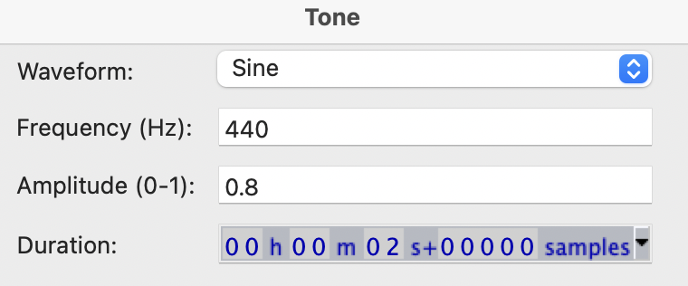
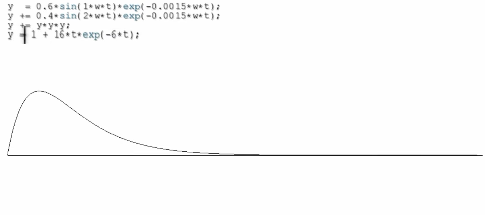
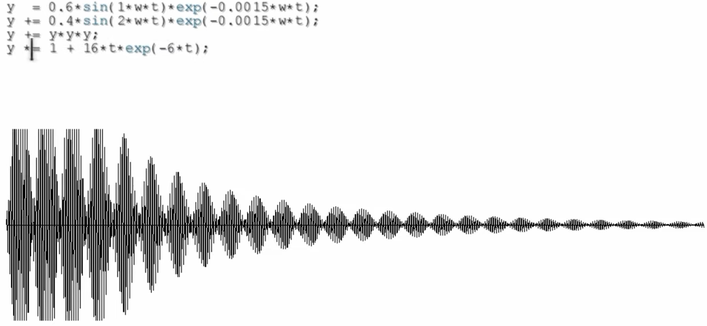
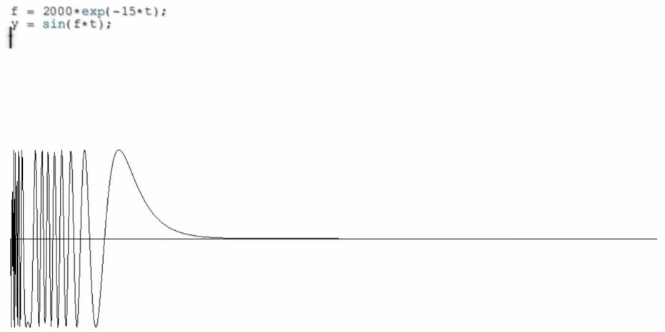
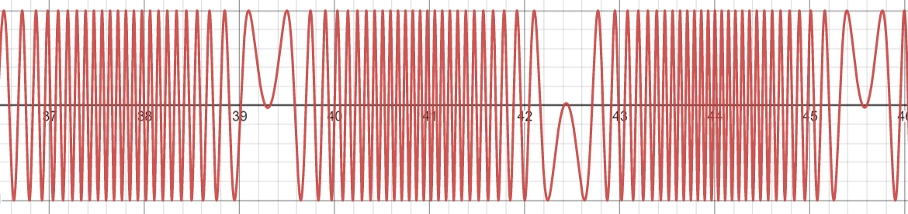

# Manipulating Sound Waves

## Sound Waves – Pitch and Amplitude

In this section, you will observe how frequency and amplitude affects
how a wave sounds.

**Frequency** refers to the number of times an oscillation occurs in a
given period of time. Frequency is measured in hertz (Hz), which is
equivalent to the number of oscillations per second. So, for example a
frequency of 20 Hz means that there are 20 oscillations that occur per
second. We perceive frequency as **pitch**; sound waves that oscillate
at higher frequencies sound higher, while lower frequencies sound lower.

**Amplitude** denotes the maximum value of an oscillation, measured from
an equilibrium point. For sound waves, amplitude is related to
**volume**. The larger the amplitude of the sound wave the louder the
sound. Volume is measured using the decibel (dB) which is a logarithmic
scale with a difference of 10 dB (or one Bell) being perceived as a
doubling of volume.

We will first be observing a pure tone. In an empty project in Audacity,
select ‘**Generate**’ &gt; ‘**Tone**’ from the toolbar at the top of the
window. Select the following settings:

- Sine wave with frequency **440 Hz**, amplitude of **0.8**, and
  duration of **2 seconds**

When you zoom in on the sound created with these settings, you should
see a pure sine wave.

Discuss the following questions as a group. Note that the general form
of a sine wave is:

*y* = *A**s**i**n*\[ *B*(*x* − *C*) \] + *D*

**1a) What is the theoretical period of the wave you have created in
Audacity?**

**1b) Examine the graph created in Audacity. Find** ***B*. What is the
calculated frequency of the wave?**

*Recall that the period of a function is given by 2π/**B***

**1c) What is the equation of the sine wave you created in Audacity?**

Play the sound that you have generated using the green play button in
the header. This is what a pure tone sounds like at 440 Hz. But what
does a pure tone sound like at a different frequency?

**Unselect** the existing track list.

A new track list can be added by right-clicking the blank space next to
the existing track list(s) and clicking “add Mono Track.”

Create a new pure tone according to the following specifications:

- Sine wave with frequency **523 Hz**, amplitude of **0.6**, and
  duration of **2 seconds**

**Click and drag** the new tone to the top track list so that it plays
from **2 seconds to 4 seconds**. Delete the bottom track list.

Play the track list again from the beginning.

**2a) What happens to the volume when transitioning between the two
waves? Why? Explain by observing the two waveforms when they
transition.**

**2b) What happens to the pitch when transitioning between the two
waves? What does this indicate about the relationship between the pitch
of a sound and its frequency?**

<table style="width:36%;">
<colgroup>
<col style="width: 19%" />
<col style="width: 16%" />
</colgroup>
<thead>
<tr>
<th style="text-align: center;">
<strong>Note</strong>

<strong>(Letter Name)</strong>
</th>
<th style="text-align: center;">
<strong>Frequency
(Hz)</strong>
</th>
</tr>
</thead>
<tbody>
<tr>
<td style="text-align: center;">
A4
</td>
<td style="text-align: center;">
440.00
</td>
</tr>
<tr>
<td style="text-align: center;">
B4
</td>
<td style="text-align: center;">
493.88
</td>
</tr>
<tr>
<td style="text-align: center;">
C5
</td>
<td style="text-align: center;">
523
</td>
</tr>
<tr>
<td style="text-align: center;">
D5
</td>
<td style="text-align: center;">
587.33
</td>
</tr>
<tr>
<td style="text-align: center;">
E5
</td>
<td style="text-align: center;">
659.25
</td>
</tr>
<tr>
<td style="text-align: center;">
F5
</td>
<td style="text-align: center;">
698.46
</td>
</tr>
<tr>
<td style="text-align: center;">
G5
</td>
<td style="text-align: center;">
784
</td>
</tr>
<tr>
<td style="text-align: center;">
A5
</td>
<td style="text-align: center;">
880.00
</td>
</tr>
</tbody>
</table>

In an equal-tempered scale – the most widely used scale – the
frequencies 440 Hz and 523 Hz correspond to musical notes. A sine wave
with a frequency of 440 Hz corresponds to an ‘A’ note while a sine wave
with a frequency of 523.23 Hz creates a ‘C’ note. The figure on the
right shows some notes and their corresponding frequencies.

Notice that there are two ‘A’ notes in the table. The two notes sound
like the same musical note, but they have different pitches;
A5 sounds higher than A4. The subscript in the
note column represents the octave that the note belongs to. The higher
the subscript, the higher the octave and perceived tone.

**3) Given that the frequency for A6 is 1760 Hz, what is the
type of mathematical relationship (linear, quadratic, etc.) between the
frequencies of the same note in different octaves?**

## Additive Synthesis

Delete the existing Audacity rack lists to start with an empty project.
Making sure that they’re on different track lists, generate two tones
according to the following specifications:

- Sine wave with frequency **523 Hz**, amplitude of **0.5**, and
  duration of **2 seconds**

- Sine wave with frequency **784 Hz**, amplitude of **0.5**, and
  duration of **2 seconds**

Try playing each tone separately by spacing them out and listening to
them separately.

Notice that the two sounds create a ‘bigger’ sound when played together.
This is because of a concept called **superimposition**. When multiple
tones are played at the same time, the sound you hear is the sum of each
pure tone. Mathematically, this can be observed by adding the waveform
functions together in graphing software such as
[Desmos](https://www.desmos.com/calculator).

Place both tones on top of each other and play to listen to them at the
same time.

The 523 Hz and the 784 Hz tones complement each other to create a
pleasant, harmonized sound when played together.

## Beats – Sound Waves with Time-Varying Amplitudes

Delete the existing Audacity track lists. Now on two **different** track
lists, generate:

- Sine wave with Frequency **300 Hz**, Amplitude of **1**, and Duration
  of **2 seconds**

- Sine wave with Frequency **305 Hz**, Amplitude of **1**, and Duration
  of **2 seconds**

**4) After playing the notes together, what do you observe that is
different from the new tones and the harmonized tones from the last
section?**

In the first set of tones (523 Hz and a 784 Hz), the frequencies are far
apart enough to create harmony. However, when two sound waves (such as
300 Hz and 305 Hz) with slightly different frequencies are played
together, they create pulses called “*Beats*”.

This phenomenon is created from the interference of the two sound waves
superimposing on each other to give the effect of the volume constantly
being raised and lowered.

Mathematically, we have
*f*(*t*) = *A*sin (300 • (2*π**t*)) + *A* *s**i**n*(305  • (2*π**t*)),
where *A* is the amplitude and *t* is time.

## Synthesizer Envelopes – Non-Constant Amplitude + Frequency

In the previous section, we heard a sine function with a time-varying
amplitude. We can use different functions to modify the amplitude over
time, and we can also have time-varying frequencies!

We can replace the non-constant amplitude from the beats section,
${2Acos\left( \left( \frac{w1 - w2}{2} \right)t \right)\sin}\left( \left( \frac{w1 + w2}{2} \right)t \right),$
with a decaying exponential such as
${16e}^{( - 6\*t)}\sin\left( \left( \frac{w1 + w2}{2} \right)t \right)$
. This will make the sine function look and sound different since the
amplitude (and consequently, the volume) of the note decreases as the
note is playing. Below are some visual examples:

Non-constant Amplitude

Now we can apply the same concept for the frequency of a sine function.
Recall the general equation of

a sine function, *y* = *A**s**i**n*\[ *ω*(*x* − *C*) \] + *D*, and that
the period of the function is given by
$\frac{\mathbf{2\pi}}{\omega}$**.** The angular frequency, *ω*, has a
reciprocal relationship to the period. This means that a small period
corresponds to a high frequency. Altering the frequency of the sine
function will result in a non-constant frequency which will cause the
pitch to fluctuate.

Did you know we can create drum-like sounds with this method? When the
frequency is defined by a decaying exponential, it causes a sharp drop
in the pitch which results in a drum-like sound. Below is a visual
example:

Non-constant Frequency

[Click here](https://youtu.be/ogFAHvYatWs?t=255) to listen to the sounds
produced from the non-constant amplitude and frequency.

Various non-constant functions can be used to define the frequency of a
wave. While a sinusoid amplitude produces a pulsing sound, a sinusoid
amplitude creates a “siren” type sound. You can observe the low and high
frequencies of a sinusoid frequency below:

## Different Types of Sound Waves 

Synthesizers are used to create different types of waves that have more
character than pure sine waves. They typically create sounds by
generating waveforms through methods including subtractive synthesis,
additive synthesis, and frequency modulation synthesis. We will examine
**triangle waves** and **square waves**, which are very commonly used in
synthesized music.

Delete all previous track lists.

Create a new sine wave with frequency **440 Hz**, amplitude of **0.8**,
and duration of **2** **seconds**.

A triangle wave can be generated in Audacity with the same process as
creating a pure sine wave. Just modify the settings to match the
following:

- **Triangle** wave with frequency **440 Hz**, amplitude of **0.85**,
  and duration of **2 seconds**

**Drag and drop** the generated triangle wave **after** the sine wave
(at 2 seconds) in the same track list.

Play the track list and notice the difference in sounds from the two
waves.

**5a) What mathematical function is the triangle wave similar to?**

**5b) Based on your previous answer, is that function differentiable
over xϵℝ? Explain why or why not.**

Differentiable sound waves are used in modulation. Effects such as
filters and phasors alter the waveform of sounds by using their
derivatives. Therefore, having a differentiable sound wave is very
valuable for people who need to alter the tone of a sound.

**5c) How could you build the triangle wave with a piecewise-defined
function?**

Similarly, we will now generate a square wave function. **Drag and
drop** the square wave right after the triangle wave with these
settings:

- **Square** wave with frequency **440 Hz**, amplitude of **0.8**, and
  duration of **2 seconds**

Play the track list with the three different waveforms. You might notice
that the square wave sounds especially harsh. Many EDM (Electronic Dance
Music) will incorporate square waves to emphasize bass drops.
